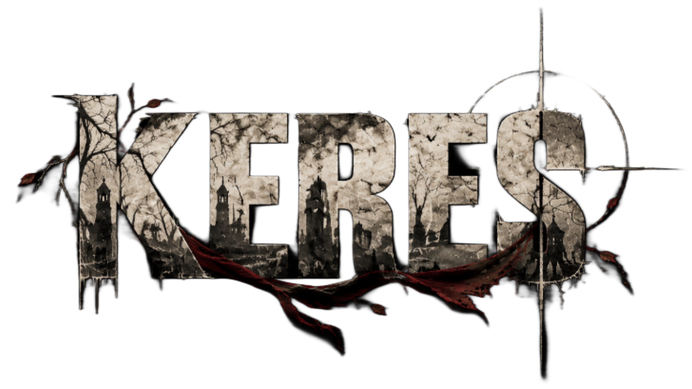
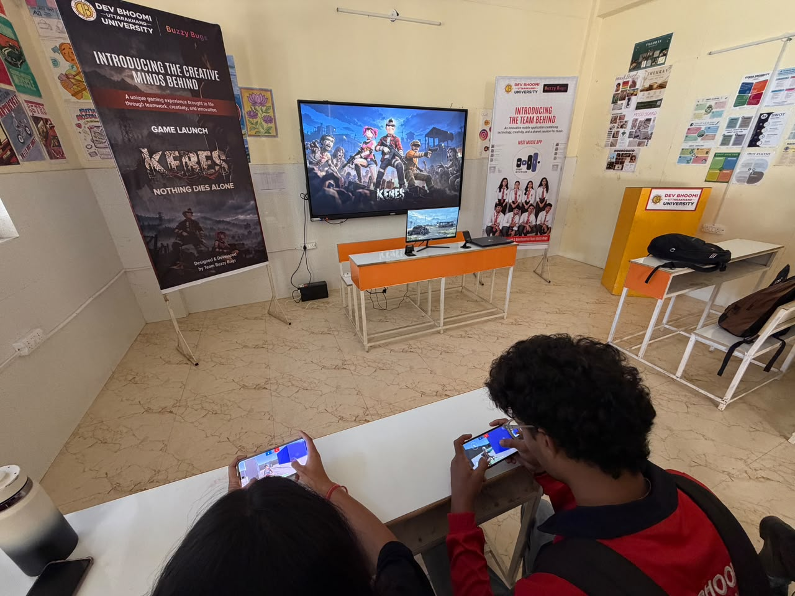
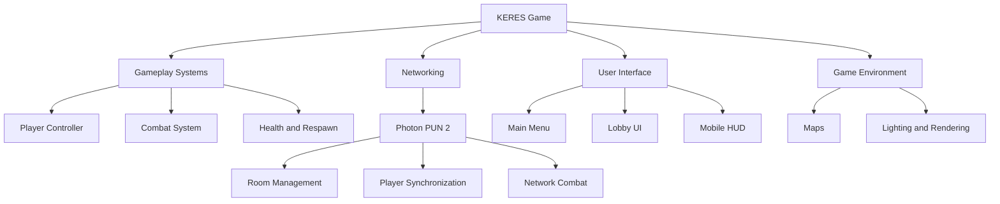
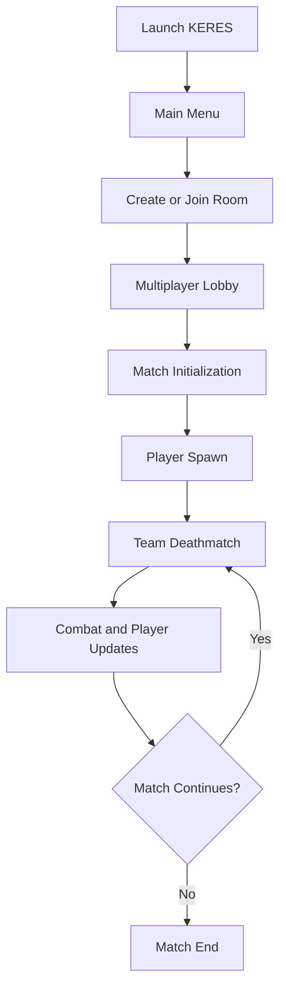

 <div align="center">



# KERES

### A Multiplayer Survival Shooter Built with Unity

**A world torn apart. A fight for survival. No second chances.**

[](https://unity.com/)
[](https://learn.microsoft.com/en-us/dotnet/csharp/)
[](https://www.photonengine.com/pun)
[](https://unity.com/)
[]()

</div>

---

## 1. Introduction

**KERES** is an independently developed multiplayer survival shooter built using Unity 6.1 and C#.

The project focuses on delivering an immersive shooter experience with multiplayer Team Deathmatch gameplay, networked player interactions, combat systems, and mobile-friendly controls.

KERES is being developed with a focus on gameplay programming, multiplayer architecture, performance optimization, and cross-platform game development.

The project combines environmental storytelling and a dark, atmospheric visual direction with competitive multiplayer gameplay.

> KERES is currently under active development. Features and implementation status documented here reflect the development prototype, not a claim of a finished commercial release.

## 2. Project Overview

| Property | Details |
|---|---|
| Project Name | KERES |
| Project Type | Multiplayer Shooter |
| Genre | Survival / Action / Shooter |
| Game Mode | Team Deathmatch (TDM) |
| Game Engine | Unity 6.1 |
| Engine Version | 6000.1.14f1 |
| Programming Language | C# |
| Networking | Photon PUN 2 |
| Rendering Pipeline | Universal Render Pipeline (URP) |
| Target Platforms | Android and PC |
| Development Status | In Development |

## 3. Game Concept

KERES is built around a dark, post-apocalyptic atmosphere where survival, combat, and exploration shape the gameplay experience.

The multiplayer prototype currently focuses on Team Deathmatch, providing a foundation for networked combat and competitive gameplay.

The broader creative direction of KERES explores psychological horror, grief, mystery, and survival.

### Core Direction

- Atmospheric and immersive environments
- Dark, low-saturation visual identity
- Multiplayer combat experience
- Responsive player movement
- Mobile and desktop gameplay support
- Performance-conscious environment design

## 4. Features & Development Status

The following table distinguishes implemented systems from features still undergoing development.

| Feature | Status |
|---|---|
| Unity 6 project setup | Implemented |
| Photon PUN 2 integration | Integrated |
| Multiplayer lobby foundation | Implemented |
| Room creation and joining | In development |
| Team Deathmatch map | Prototype |
| Player movement and combat | Implemented / Iterating |
| Health system | Implemented |
| Mobile joystick controls | Implemented / Iterating |
| Shooting mechanics | Implemented / Iterating |
| Player respawn | In development |
| Networked combat synchronization | In development |
| Multiplayer HUD | In development |
| Android build pipeline | Available |
| PC build pipeline | Development target |
| Performance optimization | Ongoing |

*Status is based on the development information available for this repository and has not been independently verified through a fresh build or multiplayer test.*

## 5. Screenshots & Gameplay

Visual documentation of the actual development build.

### Player Experience

<!-- Replace with an actual photograph of a player using KERES -->

<div align="center">


<p><i>KERES — Real-world gameplay experience</i></p>
</div>

## 6. Technology Stack

| Category | Technology | Purpose |
|---|---|---|
| Game Engine | Unity 6.1 | Core development |
| Programming | C# | Gameplay and systems |
| Networking | Photon PUN 2 | Multiplayer connectivity |
| Rendering | URP | Real-time rendering |
| Camera | Cinemachine | Camera management |
| Input | Unity Input System | Player input |
| UI | Unity UI / UGUI | Game interface |
| Physics | Unity Physics | Collision and interactions |
| Platform | Android | Mobile deployment |
| Development | Visual Studio / VS Code | Programming |
| Version Control | Git & GitHub | Source management |

## 7. Architecture Overview

KERES is organized around gameplay, networking, player management, and user-interface systems.

### High-Level Architecture



### Multiplayer Architecture

KERES uses Photon PUN 2 as its multiplayer networking foundation.

The networking layer is designed to support:

- Multiplayer room management
- Networked player initialization
- Player synchronization
- Network-aware gameplay interactions
- Multiplayer match management

### Gameplay Flow



*Diagrams represent the intended high-level system flow, not a complete verified implementation.*

## 8. Project Structure

```text
KERES/
│
├── Assets/
│   ├── _mygame/
│   │   ├── scripts/
│   │   │   ├── Player/
│   │   │   ├── Network/
│   │   │   └── ...
│   │   │
│   │   ├── scenes/
│   │   ├── prefabs/
│   │   ├── materials/
│   │   ├── sprite/
│   │   └── ...
│   │
│   ├── Photon/
│   ├── Resources/
│   └── ...
│
├── Packages/
│   ├── manifest.json
│   └── packages-lock.json
│
├── ProjectSettings/
│
├── Documentation/
│   └── Screenshots/
│
├── README.md
└── .gitignore
```

*This is a simplified documentation layout. Additional folders and assets are present in the Unity project.*

## 9. Core Gameplay Systems

### Player Controller

Responsible for player movement and input handling across supported platforms.

### Combat System

Handles shooting-related gameplay and player combat interactions.

### Health System

Manages player health and damage-related state.

### Networking System

Uses Photon PUN 2 to provide the multiplayer foundation, room management, and networked player interactions.

### Mobile Input System

Provides touchscreen-oriented controls, including joystick-based movement and mobile gameplay input.

### HUD System

The development HUD is designed to display relevant gameplay information, including:

- Crosshair
- Health
- Ammunition
- Reload feedback
- FPS information
- Network status

## 10. Prerequisites

To open and work with the project:

- Unity Hub
- Unity 6.1 (6000.1.14f1)
- Android Build Support for Android builds
- Visual Studio or VS Code
- Git
- Photon PUN 2 SDK
- A valid Photon App ID for multiplayer testing

## 11. Installation & Setup

### Clone the Repository

```bash
git clone https://github.com/iaaryans/keres.git

cd keres
```

### Open in Unity

1. Open Unity Hub.
2. Select Add Project from Disk.
3. Select the cloned KERES directory.
4. Open using Unity 6.1.
5. Allow Unity to import assets and resolve packages.

### Configure Photon

1. Open the Photon Server Settings asset.
2. Configure your own Photon App ID.
3. Verify the Photon connection settings.
4. Launch the project and test multiplayer connectivity.

Do not commit private credentials or development secrets.

## 12. Building the Project

### Android Build

1. Open Unity.
2. Navigate to File → Build Profiles.
3. Select Android.
4. Ensure Android Build Support is installed.
5. Configure the required Player Settings.
6. Build the APK.

### PC Build

1. Open Build Profiles.
2. Select Windows.
3. Configure the target architecture.
4. Build the executable.

*Build instructions describe the intended workflow; successful builds should be verified on the target device.*

## 13. Performance & Optimization

Performance optimization is an ongoing part of KERES development.

Areas being addressed include:

- Level of Detail (LOD)
- Occlusion Culling
- Static Batching
- Draw-call reduction
- Texture and material optimization
- URP rendering optimization
- Mobile performance profiling
- Memory management

The goal is to maintain a consistent gameplay experience across supported hardware.

## 14. Testing

Testing focuses on validating gameplay functionality and multiplayer behavior.

Key testing areas:

| Area | Testing Focus |
|---|---|
| Player Movement | Movement and input responsiveness |
| Combat | Shooting and damage |
| Health | Health updates |
| Networking | Player synchronization |
| Multiplayer | Room and match behavior |
| Mobile | Touchscreen controls |
| Android | Build and device compatibility |
| Performance | FPS and memory usage |

Automated test coverage and complete platform validation are not yet documented.

## 15. Current Development Focus

The current development priorities are:

1. Stabilizing the multiplayer foundation.
2. Improving player synchronization.
3. Refining combat and respawn systems.
4. Improving mobile controls.
5. Completing and validating the TDM gameplay loop.
6. Optimizing rendering and performance.
7. Improving overall gameplay stability.

## 16. Known Limitations

KERES is an active development project. Some systems are still undergoing refinement.

- Multiplayer gameplay requires further validation.
- Combat synchronization needs continued testing.
- Mobile and desktop input require platform-specific testing.
- Performance varies depending on device hardware.
- The current development build should not be considered a final release.

## 17. Contributing

Contributions, suggestions, and technical discussions are welcome.

For significant changes:

1. Fork the repository.
2. Create a dedicated branch.
3. Make focused changes.
4. Test your modifications.
5. Submit a Pull Request with a clear description.

```bash
git checkout -b feature/your-feature
git add .
git commit -m "Add: your feature"
git push origin feature/your-feature
```

## 18. License

The repository's licensing terms should be specified before public distribution.

Third-party assets, plugins, SDKs, and libraries remain subject to their respective licenses and usage restrictions.

## 19. Acknowledgements

KERES is built using the Unity ecosystem and third-party development tools.

- [Unity Technologies](https://unity.com/)
- [Photon Engine](https://www.photonengine.com/)
- [Cinemachine](https://unity.com/features/cinemachine)
- [Unity Asset Store](https://assetstore.unity.com/)

Thanks to the developers and creators whose tools and resources support the development of this project.

---

<div align="center">

### KERES

**Built with passion. Developed through persistence.**

*An independent game development project.*

</div>